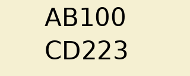

# WATERec OCR: experiments, benchmarks and notebooks

[Download the public energy-meter example](notebooks/00_download_ocr_example.ipynb), then open [1_dataset_preparation.ipynb](notebooks/1_dataset_preparation.ipynb). Set `WATEREC_CONFIG=configs/energy_meter.yaml` in the kernel environment (for example, `%env WATEREC_CONFIG=configs/energy_meter.yaml`) before running dataset preparation. Run the numbered notebooks in the same kernel environment.

[Train in Jupyter](notebooks/2_model_training.ipynb) · [Copy the TensorRT runtime](notebooks/6_trt_inference.ipynb)

## Compare the tested TensorRT profiles

### Price tags


Expected output is `107.25 DH`. On real tags, cents can be raised or smaller, a currency symbol can split the amount, and unit prices can compete with the headline price. [Open a real benchmark price tag](https://prices.openfoodfacts.org/img/price-tags/000/123/000123564.webp)


| Model | Params | Input | Corrected tags | Public photos | Latency¹ | GPU¹ |
|---|---:|---|---:|---:|---:|---:|
| WATERec rank-192 | 20.84M | ≤896 patches | **163/206** | **49/71** | 1.17 ms | 724 MiB |
| [PP-OCRv6](https://github.com/algofly-oss/ppocrv6-ocr-training) Medium | 15.58M | 128×320 | **163/206** | 6/71 | 0.77 ms | 656 MiB |
| PP-OCRv6 Small | 3.04M | 128×320 | 160/206 | 13/71 | **0.60 ms** | 652 MiB |
| [Florence-2](https://github.com/algofly-oss/florence2-ocr-training) Base | 231.41M | 384×384 | 157/206 | 3/71 | 4.95 ms | 1,452 MiB |
| [PARSeq](https://github.com/algofly-oss/parseq-ocr-training) Fast Tiny | 6.05M | 48×192 | 44/206 | 2/71 | 0.89 ms | 688 MiB |

¹ Mean from decoded RGB on the corrected price crops, RTX 5090, batch one. GPU memory is the sampled process peak. Ranking prioritizes corrected exact matches, then public exact matches. The corrected set includes 68 provisional labels.

### License plates



Expected output is `AB100CD223`. On real crops the reader must keep the character order across unfamiliar fonts, stacked rows, glare, and blur.


The international evaluation uses this crop from the OpenALPR benchmark. The recognizer receives the cropped plate and the expected text is `AYO9034`. [Source photograph](https://github.com/openalpr/benchmarks/blob/9790ed20d475be1e940a7e2a3f492a97c2ebed9b/endtoend/br/AYO9034.jpg)

| Model | Params | Input | Reviewed unseen | Local validation | Latency² | GPU² |
|---|---:|---|---:|---:|---:|---:|
| WATERec speculative | 27.51M | ≤512 patches | **879/984** | **2,476/2,693** | 1.07 ms | 700 MiB |
| Florence-2 Base | 231.41M | 224×224 | 857/984 | 2,381/2,693 | 4.88 ms | 1,130 MiB |
| PARSeq Fast Tiny | 6.05M | 48×192 | 715/984 | 2,377/2,693 | 0.69 ms | 682 MiB |
| [CCT-S](https://github.com/algofly-oss/cct-ocr-training) | 0.98M | 64×128 | 628/984 | 2,226/2,693 | 0.85 ms | 542 MiB |
| PP-OCRv6 Medium | 15.58M | Height 48 | 626/984 | 2,339/2,693 | 0.76 ms | 650 MiB |

² Mean from decoded RGB, RTX 5090, batch one. WATERec and Florence-2 timing used the 984 reviewed crops. Other timings come from separate workloads. Ranking uses reviewed unseen exact matches.

All accuracy scores count complete exact strings. Use WATERec when unfamiliar plates or price layouts matter most. PP-OCRv6 Small is the fastest tested option on the corrected price crops. See [the detailed comparison](docs/model_comparison.md) for more variants, encoded timings, and protocol notes.

<details>
<summary>All benchmark variants and historical tables</summary>

<!-- ocr-family-comparison:start -->

## Choose an OCR model

### Price-tag OCR

#### Price development

| Rank | Model family | Variant | Parameters | Input H×W | Exact match | RGB / encoded mean | GPU peak |
|---:|---|---|---:|---|---:|---:|---:|
| 1 | Florence-2 | Base, optimized TensorRT price | 231.41M | 384×384 | 106/144 (73.61%) | 5.37 / 5.62 ms | 1,454 MiB |
| 1 | [WATERec](https://github.com/algofly-oss/waterec-ocr-training) | R2048, price | 26.12M | 128×256 | 106/144 (73.61%) | 1.97 / 2.20 ms | 716 MiB |
| 3 | [Florence-2](https://github.com/algofly-oss/florence2-ocr-training) | Base, PyTorch price | 231.41M | 384×384 | 105/144 (72.92%) | 35.37 / 35.53 ms | 1,768 MiB |
| 4 | [PP-OCRv6](https://github.com/algofly-oss/ppocrv6-ocr-training) | Medium mixed, price | 15.58M | 128×320 | 104/144 (72.22%) | 0.88 / 1.09 ms | 654 MiB |
| 4 | PP-OCRv6 | Medium FP32, price | 15.58M | 128×320 | 104/144 (72.22%) | 1.41 / 1.69 ms | 588 MiB |
| 6 | CCT | CCT64, price | 0.98M | 64×128 | 66/144 (45.83%) | 0.75 / 0.94 ms | 542 MiB |
| 7 | CCT | CCT128, price | 1.15M | 128×256 | 65/144 (45.14%) | — | — |

#### Broader corrected price

| Rank | Model family | Variant | Parameters | Input H×W | Exact match | RGB / encoded mean | GPU peak |
|---:|---|---|---:|---|---:|---:|---:|
| 1 | WATERec | Original TensorRT | 26.12M | ≤1,024 patches | 167/206 (81.07%) | 1.11 / 1.31 ms | 702 MiB |
| 2 | [WATERec](https://github.com/algofly-oss/waterec-ocr-training) | R2048, price | 26.12M | 128×256 | 163/206 (79.13%) | 1.97 / 2.20 ms | 716 MiB |
| 2 | PP-OCRv6 | Currency-adapted TensorRT | 15.58M | 128×320 | 163/206 (79.13%) | 0.77 / 1.00 ms | 656 MiB |
| 4 | WATERec | Photo-adapted TensorRT | 26.12M | 896 patches | 162/206 (78.64%) | 1.07 / 1.29 ms | 696 MiB |
| 5 | PP-OCRv6 | Currency-adapted native | 15.58M | 128×320 | 161/206 (78.16%) | 5.43 / 5.43 ms | 724 MiB |
| 6 | PP-OCRv6 | Small, currency-adapted TensorRT | 3.04M | 128×320 | 160/206 (77.67%) | 0.60 / 0.82 ms | 652 MiB |
| 7 | Florence-2 | Base, PyTorch price | 231.41M | 384×384 | 159/206 (77.18%) | 33.37 / 35.30 ms | 1,768 MiB |
| 8 | Florence-2 | Base, optimized TensorRT price | 231.41M | 384×384 | 157/206 (76.21%) | 4.95 / 5.22 ms | 1,452 MiB |
| 9 | WATERec | Rank 128, photo-adapted TensorRT | 17.87M | 896 patches | 154/206 (74.76%) | 1.08 / 1.34 ms | 696 MiB |
| 10 | PARSeq | Fast Tiny, TensorRT price | 6.05M | 48×192 | 44/206 (21.36%) | 0.89 / 1.11 ms | 688 MiB |

#### Unseen retail photos

The three public photo cohorts contain 71 scorable references. Rows are ordered by full-string exact matches across the three cohorts.

| Model and TensorRT variant | Parameters | Input | Earlier | Confirmation | Fresh | Total exact | Tiled WebP mean | Tiled GPU peak |
|---|---:|---|---:|---:|---:|---:|---:|---:|
| WATERec rank 192 + paired-format head (diagnostic) | 20.84M | ≤896 patches | 23/31 | 15/23 | 11/17 | 49/71 (69.01%) | 2.95–5.36 ms | 702 MiB |
| WATERec full + paired-format head (experimental) | 26.15M | ≤896 patches | 23/31 | 14/23 | 10/17 | 47/71 (66.20%) | 2.98–5.43 ms | 702 MiB |
| WATERec full + formatting head (experimental) | 26.15M | ≤896 patches | 23/31 | 9/23 | 11/17 | 43/71 (60.56%) | 2.92–5.33 ms | 702 MiB |
| WATERec rank 128 + formatting head (experimental) | 17.89M | ≤896 patches | 18/31 | 9/23 | 8/17 | 35/71 (49.30%) | 2.95–5.25 ms | 702 MiB |
| WATERec full, photo-adapted | 26.12M | ≤896 patches | 18/31 | 5/23 | 5/17 | 28/71 (39.44%) | — | — |
| WATERec rank 128, photo-adapted | 17.87M | ≤896 patches | 17/31 | 7/23 | 4/17 | 28/71 (39.44%) | — | — |
| PP-OCRv6 Small, currency-adapted | 3.04M | 128×320 | 8/31 | 2/23 | 3/17 | 13/71 (18.31%) | — | — |
| PP-OCRv6 Medium, currency-adapted | 15.58M | 128×320 | 3/31 | 0/23 | 3/17 | 6/71 (8.45%) | — | — |
| Florence-2 Base, optimized | 231.41M | 384×384 | 3/31 | 0/23 | 0/17 | 3/71 (4.23%) | — | — |

The timing range spans the three cohort means from encoded bytes in RAM at batch one. The paired-format head reads the visible separator and currency from image features. The full paired model matched stock at 162/206 on corrected crops. The rank-192 diagnostic read 163/206. Its encoder engine was 23% smaller and averaged 1.174 ms from decoded crops versus 1.135 ms for the full paired model. Preparing lossless, model-sized BMPs at ingestion preserved all 71 predictions and ran in 1.07–1.13 ms at 698 MiB. The prepared-input timings exclude ingest conversion.

#### Historical price

| Rank | Model family | Variant | Parameters | Input H×W | Exact match | RGB / encoded mean | GPU peak |
|---:|---|---|---:|---|---:|---:|---:|
| 1 | [WATERec](https://github.com/algofly-oss/waterec-ocr-training) | Compact restart2, static batch 1 | 17.91M | 2,048 → 512 selected patches | 161/206 (78.16%) | 1.39 ms / — | 708 MiB |
| 1 | [PP-OCRv6](https://github.com/algofly-oss/ppocrv6-ocr-training) | Medium, historical price | 15.58M | 128×320 | 161/206 (78.16%) | 1.18 ms / — | 654 MiB |
| 3 | WATERec | R rank128 | 17.86M | 2,048 patches | 159/206 (77.18%) | 1.62 ms / — | 714 MiB |
| 4 | WATERec | R1024 | 26.12M | 88×180 | 154/206 (74.76%) | 1.09 ms / — | 700 MiB |
| 5 | WATERec | R2048 | 26.12M | 128×256 | 153/206 (74.27%) | 1.68 ms / — | 716 MiB |
| 6 | WATERec | R512 | 26.12M | 64×128 | 149/206 (72.33%) | 0.82 ms / — | 688 MiB |
| 7 | [PARSeq](https://github.com/algofly-oss/parseq-ocr-training) | Base, price | 23.98M | 64×256 | 148/206 (71.84%) | — | — |
| 8 | PARSeq | Tiny, native BF16 price | 6.09M | 64×256 | 118/206 (57.28%) | — | — |
| 9 | PARSeq | Fast Tiny, price | 6.05M | 48×192 | 112/206 (54.37%) | 0.89 / 1.09 ms | 688 MiB |

### License-plate recognition (LPR)

#### LPR development

| Rank | Model family | Variant | Parameters | Input H×W | Exact match | RGB / encoded mean | GPU peak |
|---:|---|---|---:|---|---:|---:|---:|
| 1 | [WATERec](https://github.com/algofly-oss/waterec-ocr-training) | Adapted 512-patch TensorRT, plates | 26.12M | 64×128 dev | 1,075/1,167 (92.12%) | 1.27 / 1.44 ms | 686 MiB |
| 2 | PP-OCRv6 | Medium height 128, plates | 15.58M | 128×320 bound | 1,027/1,167 (88.00%) | 0.96 / 1.09 ms | 654 MiB |
| 3 | PP-OCRv6 | Medium height 48, plates | 15.58M | Height 48 | 1,001/1,167 (85.78%) | 0.76 / 0.94 ms | 650 MiB |
| 4 | [CCT](https://github.com/algofly-oss/cct-ocr-training) | CCT-S, plates | 0.98M | 64×128 | 953/1,167 (81.66%) | 0.85 / 1.03 ms | 542 MiB |

#### LPR validation

| Rank | Model family | Variant | Parameters | Input H×W | Exact match | RGB / encoded mean | GPU peak |
|---:|---|---|---:|---|---:|---:|---:|
| 1 | [WATERec](https://github.com/algofly-oss/waterec-ocr-training) | Adapted 512-patch TensorRT, plates | 26.12M | 64×128 dev | 2,477/2,693 (91.98%) | 1.27 / 1.44 ms | 686 MiB |
| 2 | WATERec | Speculative TensorRT with orientation correction | 27.76M | ≤512 patches | 2,476/2,693 (91.94%) | — | — |
| 3 | WATERec | RS, plates | 26.12M | Aspect-preserving, ≤512 patches | 2,475/2,693 (91.90%) | 1.26 / 2.26 ms | 694 MiB |
| 4 | Florence-2 | Base, optimized TensorRT plates | 231.41M | 224×224 | 2,381/2,693 (88.41%) | — | — |
| 5 | PARSeq | Fast Tiny, plates | 6.05M | 48×192 | 2,377/2,693 (88.27%) | 0.69 / 1.66 ms | 682 MiB |
| 6 | [PP-OCRv6](https://github.com/algofly-oss/ppocrv6-ocr-training) | Medium height 128, plates | 15.58M | 128×320 bound | 2,368/2,693 (87.93%) | 0.96 / 1.09 ms | 654 MiB |
| 7 | [PP-OCRv6](https://github.com/algofly-oss/ppocrv6-ocr-training) | Medium height 48, plates | 15.58M | Height 48 | 2,339/2,693 (86.85%) | 0.76 / 0.94 ms | 650 MiB |
| 8 | [CCT](https://github.com/algofly-oss/cct-ocr-training) | CCT-S, plates | 0.98M | 64×128 | 2,226/2,693 (82.66%) | 0.85 / 1.03 ms | 542 MiB |

#### Reviewed unseen plates

| Rank | Model family | Variant | Parameters | Input H×W | Exact match | RGB / encoded mean | GPU peak |
|---:|---|---|---:|---|---:|---:|---:|
| 1 | WATERec | Speculative TensorRT | 27.51M | ≤512 patches | 879/984 (89.33%) | 1.07 / 2.71 ms | 700 MiB |
| 2 | WATERec | Speculative TensorRT with orientation correction | 27.76M | ≤512 patches | 878/984 (89.23%) | 1.17 / 2.84 ms | 700 MiB |
| 3 | Florence-2 | Base, optimized TensorRT plates | 231.41M | 224×224 | 857/984 (87.09%) | 4.88 / 6.56 ms | 1,130 MiB |
| 4 | [WATERec](https://github.com/algofly-oss/waterec-ocr-training) | Adapted 512-patch TensorRT, plates | 26.12M | 64×128 dev | 855/984 (86.89%) | 1.27 / 1.44 ms | 686 MiB |
| 5 | WATERec | Rank 128, TensorRT plates | 17.86M | ≤512 patches | 849/984 (86.28%) | 1.18 / 2.82 ms | 696 MiB |
| 6 | PARSeq | Fast Tiny, plates | 6.05M | 48×192 | 715/984 (72.66%) | 0.69 / 1.66 ms | 682 MiB |
| 7 | [CCT](https://github.com/algofly-oss/cct-ocr-training) | CCT-S, plates | 0.98M | 64×128 | 628/984 (63.82%) | 0.85 / 1.03 ms | 542 MiB |
| 8 | PP-OCRv6 | Medium height 48, plates | 15.58M | Height 48 | 626/984 (63.62%) | 0.76 / 0.94 ms | 650 MiB |
| 9 | PP-OCRv6 | Medium height 128, plates | 15.58M | 128×320 bound | 534/984 (54.27%) | 0.96 / 1.09 ms | 654 MiB |

The optional RGB-array API for speculative WATERec averaged 0.981 ms on the same 984 upright plates, preserving all output strings at 700 MiB. BMP reached 1.050 ms from in-memory bytes with about twice the original PNG payload.

- **Fast recognition on a tight latency budget:** start with PP-OCRv6. Its currency-adapted TensorRT build reached 163/206 in the corrected-crop comparison.
- **Unseen plate layouts:** start with WATERec. The 512-patch speculative checkpoint reached 879/984 on reviewed unseen crops. With orientation correction it read 880/984 at 90°, 880/984 at 180°, and 881/984 at 270°.
- **Smallest model:** CCT-S is about 1M parameters. Use it when the input resembles its training distribution.
- **Custom text selection and ordering:** benchmark Florence-2 on your own annotation policy. Its faster TensorRT path lost two exact matches versus PyTorch on the broader price-tag evaluation.

Timings are batch 1 on an RTX 5090, with preprocessing, recognition and text decoding included. Encoded scope includes image decoding and may include file reads in historical runs. GPU peak is driver-accounted memory. Exact match uses the literal full string. The LPR validation table includes separate WATERec checkpoints identified in the variant column. Compare accuracy within the same label version and split: historical PARSeq price scores use an earlier label policy, and the broader corrected price cohort includes 68 provisional labels. A dash means a comparable result is unavailable. The corrected price timings use the same 206 images for PP-OCRv6, the photo-adapted WATERec profiles, Florence-2 and Fast Tiny. The two original WATERec rows retain development-crop timings. The reviewed unseen plate timings for speculative WATERec, rank-128 WATERec and Florence-2 use the same 984 images. Other timing rows use their original benchmark workloads. The latest Florence values are research measurements; see its repository for the executable versions.

<!-- ocr-family-comparison:end -->

</details>

Our experiments with compact OCR for license plates and difficult price tags, with a notebook workflow for training and ONNX/TensorRT deployment. The organization follows our [Florence-2 repository](https://github.com/algofly-oss/florence2-ocr-training): numbered notebooks, Docker/JupyterLab, an optional text annotator, and example data.

**Compare the models:** [ALPR and price accuracy, latency and GPU-memory tables](docs/model_comparison.md).

**Start with the findings:** [scenario capabilities](docs/capabilities.md), [experiments and methodology](docs/experiments.md), and [machine-readable reference measurements](results/reference_metrics.json). The included fictional images exercise the workflow; they are not the benchmark data and do not reproduce the reported accuracy.

Related repositories: [PARSeq Base / Tiny / Fast Tiny](https://github.com/algofly-oss/parseq-ocr-training), [CCT-S plate OCR](https://github.com/algofly-oss/cct-ocr-training), and [Florence-2](https://github.com/algofly-oss/florence2-ocr-training).

For the measured price accuracy/latency/memory tradeoff at 512/1024/2048 patch budgets, see the [lower-resolution reference table](docs/experiments.md#price-resolution-measured-lower-budget-alternatives) and [scoped aggregate metadata](results/resolution_reference.json). The checkpoints have different training recipes; GPU-preprocessing timings do not automatically describe the default runtime.

## Model choices

| Choice | What changes | Starting configuration |
|---|---|---|
| WATERec RS, plate profile | RS initialization, 512-patch budget | `configs/waterec_alpr.yaml` |
| WATERec R, plate profile | R initialization; same architecture/size | `configs/waterec_r_alpr.yaml` |
| WATERec R, detailed price profile | SPACE output, 2,048-patch budget | `configs/waterec_price.yaml` |
| Alternate resolution profiles | 1,024-patch plates or 512-patch prices; validate separately | `configs/waterec_alpr_1024.yaml`, `configs/waterec_price_512.yaml` |
| Experimental speculative decoding | Extra 1,386,624-parameter draft bound to its OCR checkpoint; optional, plate/512 only | Notebook 8 |

R and RS are different pretrained checkpoints of the **same** 12-layer 384-wide encoder and two-layer autoregressive decoder. Changing resolution changes computation, not parameter count. There is no validated official “WATERec Fast Tiny” variant here: **Fast Tiny belongs to PARSeq**, documented in its separate repository. The latest 17.9M custom research terminal reaches **161/206 exact matches (78.16%)** at 1.356083 ms RGB /708 MiB in public runtime v3. It is available through a separate experimental workflow, not a standard R/RS pretrained option. See the [compact research update](docs/compact_research.md) for historical results and explicit limits.

## Run like the Florence repository

With Docker, Docker Compose and NVIDIA Container Toolkit installed:

```bash
docker compose up --build
```

Open JupyterLab at **http://localhost:8780** (default local token `waterec-local`) and the optional text annotator at **http://localhost:8000**. Set `JUPYTER_TOKEN` in your local environment or `.env` to change it. Add your own annotator images to `annotator/static/images`; labels are same-stem text files. Docker services bind to localhost. Container execution needs a compatible NVIDIA driver; inspect the validation record for what was actually tested.

Or use a virtual environment:

```bash
python -m pip install -e '.[notebooks,onnx]'
# On the target NVIDIA/CUDA system, for engine building/inference:
python -m pip install -e '.[build,tensorrt]'
jupyter lab notebooks
```

For inference-only installation without Torch or notebook/export packages, see
[lean TensorRT deployment](docs/lean_deployment.md). Native PyTorch use and training
without notebooks require the `training` extra.

## Notebook workflow

| Notebook | Purpose |
|---|---|
| [0. Model options](notebooks/0_model_options.ipynb) | Findings, R/RS, resolution and inference tradeoffs |
| [1. Dataset preparation](notebooks/1_dataset_preparation.ipynb) | Inspect fictional plate/price examples and validate image/text pairs |
| [2. Model training](notebooks/2_model_training.ipynb) | Editable dataset, batch, training loop, prediction and exact-match evaluation cells |
| [3. Native inference](notebooks/3_inference.ipynb) | PyTorch prediction and evaluation |
| [4. ONNX export](notebooks/4_onnx_export.ipynb) | Dense-RoPE encoder/cross-KV and cached-decoder export |
| [5. ONNX inference](notebooks/5_onnx_inference.ipynb) | CPU ONNX Runtime inference and native-string comparison |
| [6. TensorRT inference](notebooks/6_trt_inference.ipynb) | Copyable Python runtime with automatic engine builds and a one-image inference example |
| [7. Evaluation and benchmark](notebooks/7_evaluation_and_benchmark.ipynb) | Evaluation and timing scopes; current accuracy policy is literal exact match |
| [8. Optional acceleration](notebooks/8_optional_acceleration.ipynb) | Explicit GPU preprocessing, orientation and speculative options |
| [9. Experimental compact workflow](notebooks/9_experimental_compact_workflow.ipynb) | Multistage rank recovery, image-only token selection and separate deployment |

Notebooks default to `configs/dummy_alpr.yaml`; set `WATEREC_CONFIG=configs/dummy_price.yaml` for the price examples. Dummy training is one epoch, CPU FP32 and decoder warmup. It downloads the selected SHA-verified upstream pretrained weights; no private fine-tuned weights are included. GPU/build/benchmark cells are explicit opt-ins. Saved notebook outputs are cleared.

## Experimental compact workflow

A separate opt-in `waterec-compact` command (or `python -m waterec_ocr.waterec_compact_cli`) now supports native training, ONNX export, target-specific TensorRT build and inference. See [the workflow guide](docs/compact_workflow.md) and notebook 9. It uses multistage distillation, **not** the one-step Florence recipe. One-epoch defaults are demonstrations, not an accuracy recipe; no reference checkpoint is bundled. Supplied-teacher provenance is the caller's responsibility. There is no automatic resume, universal charset, dynamic-engine-budget, edge or rotation guarantee.

The audited reference checkpoint's current public runtime v3 measured **1.356083 ms RGB /1.620985 ms encoded, 708 MiB**, with 17,913,953 parameters and a 2048-patch input reduced to 512 after six blocks. It achieves **161/206 literal exact matches (78.16%)**. Training with demonstration settings does not inherit those results. Standard R/RS commands and configurations are unchanged.

## Your data and training

```text
dataset/
  train/example.png
  train/example.txt
  val/another.png
  val/another.txt
```

Supply the complete expected text as UTF-8. Training needs **images and text only**, with no bounding boxes. Price profiles preserve spaces and decimal punctuation. Plate profiles explicitly uppercase and remove whitespace. The default vocabulary covers printable ASCII, with SPACE added for prices. An optional ordered `additional_characters` list, such as `["€", "£", "¥", "₹"]`, adds trainable character rows with strict checkpoint/alphabet metadata. Mean initialization does not recognize new symbols without training. Extended alphabets currently use the original static-B1 ONNX/TensorRT path; see the [compact workflow](docs/compact_workflow.md). The cached decoder has 25 prediction steps, reserving EOS; default labels are limited to 24 characters. Longer outputs require decoder/export changes and new qualification.

```bash
waterec-ocr train --config configs/dummy_alpr.yaml
waterec-ocr infer --config configs/dummy_alpr.yaml --image dummy_data/plates/val/000.png
waterec-ocr export --config configs/dummy_alpr.yaml
waterec-ocr infer --backend onnx --config configs/dummy_alpr.yaml --image dummy_data/plates/val/000.png
waterec-ocr build --config configs/dummy_alpr.yaml
waterec-ocr infer --backend tensorrt --config configs/dummy_alpr.yaml --image dummy_data/plates/val/000.png
```

Use a new output directory when changing the data or model profile. Epoch selection uses an internal split of the training pool; external validation/OOD images remain for reporting. Training can optionally refit all training images for the selected epoch count. Starting presets are practical workflows, not a claim that their default batch/backend exactly repeats every research run; see the recipe notes.

## Resolution, batches and optional speed paths

Input resolution follows a native aspect-preserving 4×4 patch budget; it does not squeeze every crop to a fixed square. Configurations accept integer budgets ≥64, subject to memory and deployment checks. 512 and 2,048 are the measured reference operating points. Each budget requires matching exported assets and engines; an altered budget does not inherit a benchmark score.

Native PyTorch accepts image lists. Standard R/RS deployments and the original compact export use **static batch 1**. Compact ASCII checkpoints with budget 2048 and keep 512 also support explicit `--static-batch 1`, `2`, `4` or `8` deployments, with one batched encoder/decoder and padded partial tails. These are fixed-capacity profiles, not arbitrary dynamic batching; extended Unicode batching is explicitly unsupported. The [workflow guide](docs/compact_workflow.md#optional-fixed-capacity-batching) includes commands, measured latency/memory and known cross-capacity output differences. Optional GPU preprocessing preserves the Pillow resize/normalization policy but still decodes image files on the CPU. Orientation correction is a separate trained component, not native quarter-turn invariance. Experimental speculative decoding can exchange individual predictions through numerical differences and must be checked on your data. Both optional orientation/speculative workflows currently require the 512-token plate profile.

To test small crops with TensorRT, add `--upscale-small-plates` or enable `UPSCALE_SMALL_PLATES` in the [optional acceleration notebook](notebooks/8_optional_acceleration.ipynb). When crops arrive upright, use the option with the standard plate deployment. Add `--orientation` if rotation is unknown. The option doubles the crop dimensions with Lanczos interpolation when its upright width is 48–96 pixels. On 443 international plates rotated through four angles, the speculative profile gained 36 net exact reads across 1,772 views. Batch-one decoded RGB latency increased from 1.57 to 1.71 ms at 692 MiB peak GPU memory on the RTX 5090. The option defaults to off. Add `--upscale-very-small-plates` or enable `UPSCALE_VERY_SMALL_PLATES` in the same notebook to try 2× Lanczos on upright widths of 32–47 pixels. In the 40-pixel downsampled replay, exact matches rose from 528/984 to 717/984 on reviewed plates and from 227/443 to 289/443 on international plates. These are artificial low-resolution views. Both flags can be used together.

## Reproducibility and publication

See [experiments](docs/experiments.md) for scenario findings, unsuccessful approaches, source/selection boundaries and benchmark definitions. Public source includes fictional data, code, pinned upstream provenance and aggregate results; private benchmark images, annotation services, fine-tuned checkpoints, engines and credentials are excluded. TensorRT engines are GPU/software-specific and must be built locally. Dummy workflow checks establish software behavior, not OCR quality. Fresh check status is recorded separately in `results/validation_summary.json` when available.

The [current model comparison (PDF)](docs/reports/ocr_comparison_2026-11-17.pdf) puts model size, input resolution, dataset accuracy, batch latency, throughput, GPU memory and host RSS together. It separates ALPR and price tags, records unsuccessful experiments and external-photo limitations, and identifies unmeasured edge-device behavior. These are bounded research results, not a universal-accuracy claim.

Upstream: [OpenOCR-WATERec](https://github.com/YesianRohn/OpenOCR-WATERec). Source and modification notices are preserved under `waterec_ocr/_vendor/waterec`; optional resize-kernel terms are under `_native/waterec`. See [LICENSE](LICENSE) and [NOTICE](NOTICE).
